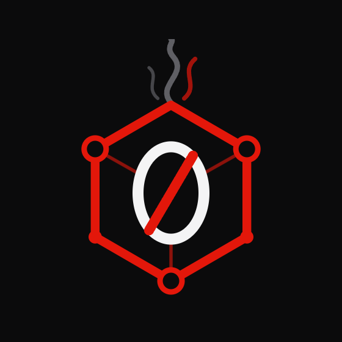
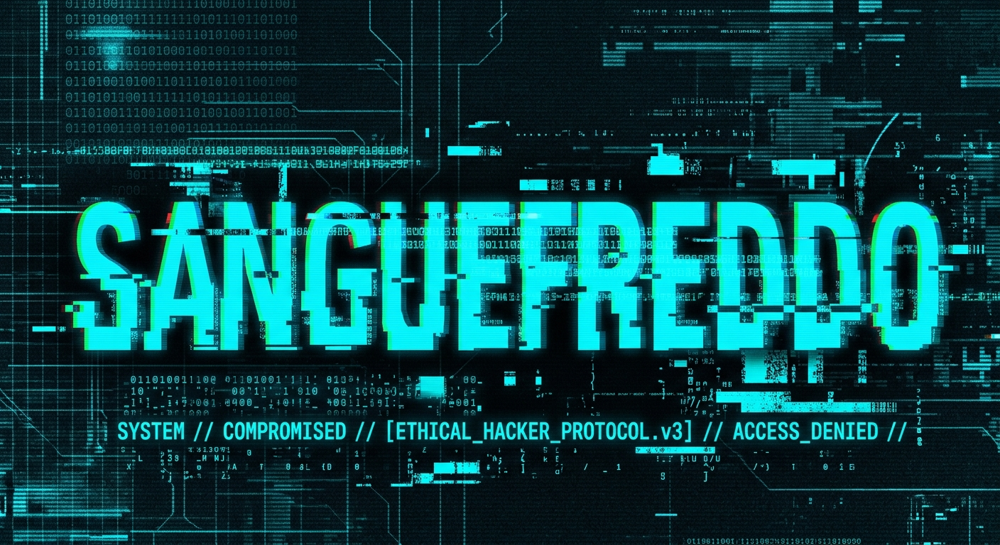

<table>
  <tr>
    <td valign="middle" width="78%">
      <h1>Zero-day Smokey</h1>
      <b>Sicurezza Informatica • Blue Team • Sicurezza di Rete • Progettazione di Reti</b>
    </td>
    <td valign="middle" align="right" width="22%">
      
    </td>
  </tr>
</table>

<p align="center">
  
  
  
  
</p>

<p align="center">
  <a href="#-chi-siamo">Chi siamo</a> |
  <a href="#-il-team">Il team</a> |
  <a href="#-zmap">Zmap</a> |
  <a href="#-progettazione-di-reti-aziendali">Progettazione di reti aziendali</a> |
  <a href="#-avvio-rapido">Avvio rapido</a> |
  <a href="#-uso-responsabile">Uso responsabile</a>
</p>

---

# 🛡️ Chi siamo

**Zero-day Smokey** è un team che si occupa di **sicurezza informatica e networking**, con un approccio orientato al **Blue Team** e alla progettazione di infrastrutture di rete.

Lavoriamo allo sviluppo di strumenti per l'analisi di rete e alla progettazione di topologie di rete con **Cisco Packet Tracer**, con l'obiettivo di aiutare aziende e organizzazioni a pianificare infrastrutture coerenti con le proprie esigenze.

# 👥 Il team

<p align="center">
  <b>Sei persone, una missione:</b> cybersecurity, Blue Team, sicurezza di rete e progettazione di infrastrutture affidabili.
</p>

<!-- Scheda Team Leader: Carmelo Sacco (SangueFreddo) -->
<table>
  <tr>
    <td width="34%" valign="top" align="center">
      
      <h3>Carmelo Sacco</h3>
      <p><b>Nickname:</b> SangueFreddo</p>
      <p><strong>👑 TEAM LEADER</strong></p>
      <p><em>«Osservare. Difendere. Progettare. Migliorare.»</em></p>
    </td>
    <td valign="top">
      <h3>🧠 Competenze</h3>
      <ul>
        <li>📡 Analisi del traffico di rete</li>
        <li>🗺️ Progettazione di topologie con Cisco Packet Tracer</li>
        <li>🔌 Scansione delle porte</li>
        <li>🐍 Sviluppo di script Python per la cybersecurity</li>
        <li>⌨️ Creazione di strumenti CLI (Command Line Interface)</li>
        <li>🛡️ Configurazione di reti e firewall</li>
        <li>🔍 Vulnerability Assessment e Sicurezza Defensiva</li>
        <li>🚨 Incident Response e Hardening dei sistemi</li>
      </ul>
    </td>
  </tr>
</table>

### 🔹 Membri del Team

<table>
  <tr>
    <td width="50%" valign="top">
      <h3>👤 Anthony Vitale</h3>
      <p><b>GitHub:</b> <a href="https://github.com/anthonyvitale2899">anthonyvitale2899</a></p>
      <p><b>Ruolo:</b> Collaboratore / Network Support</p>
      <h4>🧠 Competenze:</h4>
      <ul>
        <li>🛡️ Implementazione e settaggio firewall</li>
        <li>🗺️ Supporto alla progettazione di topologie in Cisco Packet Tracer</li>
        <li>💻 Gestione della Shell di macOS (Terminal)</li>
        <li>🌐 Configurazione base di dispositivi di rete</li>
        <li>🔍 Supporto al monitoraggio di rete</li>
      </ul>
    </td>
    <td width="50%" valign="top" align="center">
      <br/><br/>
      <p><i>Spazio riservato ai prossimi aggiornamenti del profilo di Anthony.</i></p>
    </td>
  </tr>
</table>

### 🔹 Profili in arrivo

I profili seguenti verranno completati quando saranno disponibili nome o nickname, ruolo e competenze.

<table>
  <tr>
    <td width="25%" align="center" valign="top">
      <h3>👤 Membro 3</h3>
      <p><b>Profilo in arrivo</b></p>
      <p><sub>Dettagli da definire</sub></p>
    </td>
    <td width="25%" align="center" valign="top">
      <h3>👤 Membro 4</h3>
      <p><b>Profilo in arrivo</b></p>
      <p><sub>Dettagli da definire</sub></p>
    </td>
    <td width="25%" align="center" valign="top">
      <h3>👤 Membro 5</h3>
      <p><b>Profilo in arrivo</b></p>
      <p><sub>Dettagli da definire</sub></p>
    </td>
    <td width="25%" align="center" valign="top">
      <h3>👤 Membro 6</h3>
      <p><b>Profilo in arrivo</b></p>
      <p><sub>Dettagli da definire</sub></p>
    </td>
  </tr>
</table>

---

# 🚀 Zmap

**Zmap** è uno script Python essenziale per eseguire operazioni di ricognizione e analisi di rete. È pensato per offrire un'interfaccia semplice e intuitiva: l'utente può selezionare la funzione desiderata premendo il numero corrispondente nel menu.

## 🔎 Funzionalità

- 🌐 **Individuazione degli host attivi** — aiuta a identificare gli host che rispondono nella rete analizzata.
- 🔌 **Scansione delle porte** — verifica quali porte risultano aperte sugli host selezionati.
- 🧭 **Menu interattivo** — selezione delle operazioni tramite numeri, senza dover ricordare molti comandi.
- 🖥️ **Interfaccia intuitiva da terminale** — organizzazione delle funzioni in una schermata semplice da utilizzare.

*Le funzioni effettivamente disponibili dipendono dalla versione dello script presente nel repository.*

# 🏢 Progettazione di reti aziendali

**Zero-day Smokey è specializzato nella progettazione e simulazione di topologie di rete aziendali tramite Cisco Packet Tracer.** Supportiamo le aziende nella pianificazione della propria infrastruttura di rete, dalla definizione iniziale delle esigenze fino alla preparazione del progetto tecnico.

## 🧩 Cosa offriamo

- 📋 **Analisi delle esigenze** — raccolta dei requisiti e definizione degli obiettivi della rete.
- 💶 **Preventivi** — stima dei costi e delle risorse necessarie in base alle esigenze del progetto.
- 🗺️ **Progettazione della topologia** — organizzazione di dispositivi, collegamenti e segmenti di rete tramite Cisco Packet Tracer.
- 🧪 **Simulazione e verifica** — test della topologia simulata prima dell'eventuale implementazione.
- 🛠️ **Supporto alla messa in opera** — assistenza nella fase di implementazione, configurazione e verifica della rete, secondo l'ambito concordato con il cliente.

L'obiettivo è proporre soluzioni ordinate, documentate e dimensionate sulle necessità dell'azienda. Attività, tempi, costi e responsabilità della messa in opera vengono definiti nel preventivo prima dell'avvio del lavoro.

# ⚡ Avvio rapido

Per avviare lo script, esegui il comando dalla cartella del progetto:

```bash
python Zmap.py
```